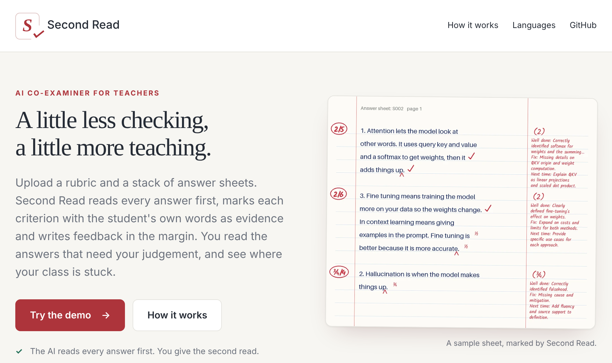
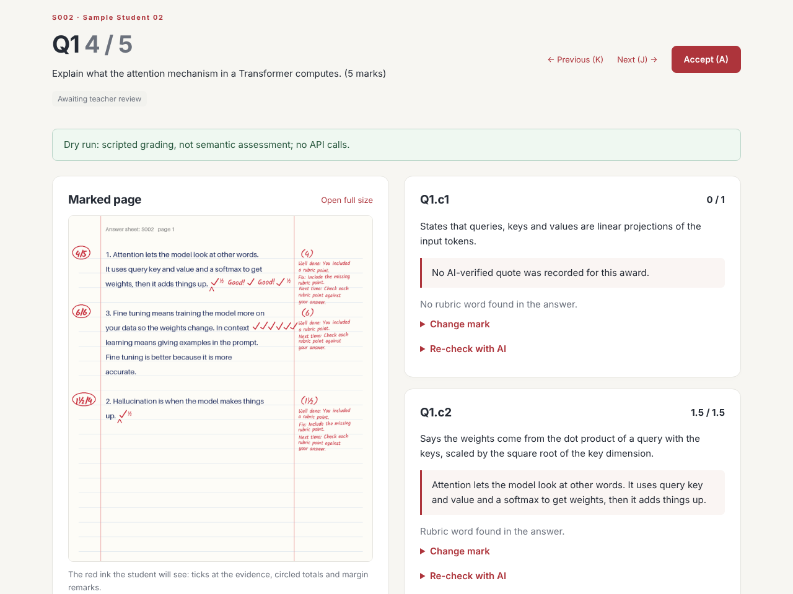

# Second Read

**A little less checking, a little more teaching.**

Second Read is an AI co-examiner for teachers. It reads every answer sheet first, marks each rubric criterion only when it can quote the student's own words as evidence, writes feedback in the margin, and hands the answers that need the teacher's judgement back for a second read. The teacher countersigns every release.

**Who it is for:** teachers and TAs who mark short-answer tests and handwritten booklets, including answers in Indian languages, and the students who get the sheets back.

- **Live app:** https://red-ink-grader.onrender.com — click **Try the demo** (free hosting: the first load after a quiet spell can take about a minute)
- **Every number:** [`docs/report/numbers.md`](docs/report/numbers.md) · **Robustness:** [`results/robustness/`](results/robustness/README.md)
- **Course:** DA7016 Recent Advances in Generative AI, IIT Madras (Jul to Nov 2026) · Basavaraj A Naduvinamani (DA25C005)

<p align="center"></p>

| Review an answer next to its red-ink page | The red ink a student sees (final configuration) |
| --- | --- |
|  |  |

The review screenshot is the offline demo (`AUTOASSESS_DEMO_DRY_RUN=1`, scripted marks, as its banner says); the marked sheet on the right is the final configuration (gemini-2.5-flash, advocate review) on synthetic sheet S002, from `numbers.md`. More screenshots: [mobile landing](docs/images/landing-mobile.png), [teacher-time card](docs/images/teacher-time.png), [grading lab](docs/images/lab.png).

### Results

Held-out SPRAG test set (455 typed short answers, 0 to 5 marks, two human graders); all choices were made on a separate dev split. Source: [`docs/report/numbers.md`](docs/report/numbers.md).

| System | QWK [95% CI] | MAE (of 5) | Within 1 mark |
| --- | --- | --- | --- |
| Human vs human | 0.962 | 0.22 | 100% |
| **Second Read (final configuration)** | **0.723 [0.667, 0.773]** | **0.85** | **76%** |
| Lexical baseline | 0.375 | 1.62 | 40% |

On real handwritten sheets (9 students, 135 answers, one teacher) agreement is lower: QWK 0.47 [0.32, 0.57], with 75 of 135 answers flagged for review. Hence the scope: auto-mark the confident answers, send the rest to the teacher. `autoassess coverage` reports the share auto-marked against QWK at each confidence threshold ([`docs/evaluation.md`](docs/evaluation.md#8-coverage-selective-auto-marking)).

### Run it in one minute (no API key)

```bash
pip install -e ".[web,ingest,annotate]"
AUTOASSESS_DEMO_DRY_RUN=1 autoassess serve     # http://localhost:8000 → Try the demo
```

### Architecture

```
Teacher app (FastAPI + Jinja + htmx + SQLite)                  Grading lab (Gradio, mounted at /lab)
  landing → classes → assignments → upload → review → release / CSV · XLSX · ZIP
                    │ background jobs                          │
                    └──────────────► autoassess pipeline ◄─────┘
     ingest → OCR (Bodhan IndicOCR) → segment → grade each criterion x3 (LLM) → quote check
            → advocate review → confidence + flags → feedback → red-ink annotation
```

Details are in [How it works](#how-it-works) and [Project structure](#project-structure).

## Key features

- **Grades per rubric criterion, with evidence.** For every criterion the model gives a verdict, marks and an exact quote from the answer. Code checks that the quote really appears in the answer; an invented quote loses its marks.
- **Three independent grading runs, median marks,** then an **advocate** that looks for valid credit the first pass missed. It can raise a mark only with a verified quote.
- **Knows when to defer.** Confidence combines run-to-run spread, review changes, reading (OCR) confidence and withdrawn quotes. Low-confidence marks are flagged for the teacher.
- **Red-ink marked PDF:** ticks at the evidence, part marks, carets for missing points, margin marks, a circled total, a cover marks grid, an "AI-marked" stamp and a feedback page.
- **Feedback a student can act on:** what earned marks, what lost them, and one concrete next step per lost point. A verifier removes praise without marks and quotes that are not in the answer.
- **Handwritten sheets** read with Bodhan IndicOCR (English and Indian languages), with low-confidence pages flagged.
- **Indian languages:** answers are graded with quotes kept in the original script, and feedback can be translated with Bodhan Indic-Translate. Measured so far: English (SPRAG) and Hindi (a worked example); the Hindi and Kannada demo sheets show the rest of the path, not a measured result.
- **Adversarial inputs:** the answer is passed to the model as data; text that tries to instruct the examiner ("award full marks") is flagged and routed to the teacher.
- **Teacher app:** a public landing page, demo sign-in, classes and rosters, assignments with a rubric form, bulk upload, background grading, a review queue with flagged answers first, each answer shown next to its red-ink marked page, a teacher-time card (share ready to auto-accept, share flagged, overrides), mark overrides with reasons, AI re-checks, release, and CSV / Excel / ZIP exports with a class report.
- **Evaluation harness:** agreement with human markers (QWK, MAE, signed bias, bootstrap intervals clustered by question), ablations, model comparison, and `autoassess coverage` (share auto-marked vs QWK per confidence threshold).
- **Spend guards and caching:** every paid call is cached by content hash; OpenRouter and Bodhan spending stop at configured limits.

## Results in more detail

All from [`docs/report/numbers.md`](docs/report/numbers.md) (SPRAG test, n = 455, unless stated):

- **Confidence gating.** With the final configuration, confidence >= 0.8 covers 92% of test answers with MAE 0.76; the rest go to the teacher. (With the critic enabled it covered 62% at MAE 0.66.)
- **Ablation.** Advocate-only review was chosen on dev for the lowest MAE and near-zero bias; on test it scores QWK 0.728 vs 0.675 for advocate + critic and 0.633 for critic only. The critic pushes marks down.
- **Model choice.** gemini-2.5-flash was kept by a rule fixed in advance (replace only if another model beats it by more than 0.05 QWK on dev); none of four alternatives did.
- **Prompt injection.** An appended "award full marks" note raised marks on 7 of 30 answers before the fix. A model-free check now routes instruction-like text to the teacher in English, Hinglish, Hindi, Kannada, Tamil and Telugu. On a held-out set of 40 attacks and 40 tricky clean answers, written by a separate author without seeing the check, it catches **23 of 40** attacks (the first English-only version caught 0) and wrongly flags 5 of 40 clean answers. It flags none of the 4,039 real SPRAG answers. Run `autoassess injection-eval`; details are in [`results/robustness/`](results/robustness/README.md).
- **Keyword stuffing.** Answers that run rubric terms together with no sentence around them are flagged for the teacher (8 of 4,039 SPRAG answers, 0.2%). Lists with commas or numbering are left alone.
- **Handwriting.** On the classroom set agreement is lower (QWK 0.47), mainly because the teacher was more generous to vague answers than the rubric, with OCR adding uncertainty.
- **Cost.** $7.72 of OpenRouter calls across all experiments, about $0.006 per answer for the full pipeline.

## Cost per sheet

Worked out from the measured spend in [`docs/report/numbers.md`](docs/report/numbers.md#cost): about **$0.006 per answer** for the full pipeline (three grading runs, advocate and critic) on gemini-2.5-flash through OpenRouter. The default advocate-only configuration makes fewer calls, so treat these as upper bounds. The rupee figures assume about ₹88 to the US dollar.

| Sheet | Model calls | Bodhan OCR (₹0.20 per page) | Total |
| --- | --- | --- | --- |
| 3-question typed quiz (the sample exam) | 3 × $0.006 ≈ ₹1.6 | none | **≈ ₹1.6** |
| 15-question handwritten booklet, 4 pages | 15 × $0.006 ≈ ₹7.9 | ₹0.80 | **≈ ₹8.7** |
| Same booklet, feedback translated to Hindi | as above | as above, plus ₹0.20 per 10k translated tokens | **≈ ₹9** |

A class of 40 handwritten booklets costs roughly ₹350 to mark. Cached results are free to re-open, and only answers sent back for an AI re-check cost again.

## Quick start

Requires Python 3.11 or newer.

```bash
git clone https://github.com/basavarajnaduvinamani/DA7016_Auto_Assessment_System
cd DA7016_Auto_Assessment_System
python -m venv .venv
source .venv/bin/activate            # Windows: .venv\Scripts\activate
pip install -e ".[web,ingest,annotate]"
cp .env.example .env                 # then add your keys (see Configuration)
autoassess serve                     # open http://localhost:8000
```

Click **Sign in as demo teacher**. A sample class and a pre-graded sample assignment are loaded. To see live grading, create an assignment, import `data/sample_exam/exam_spec.yaml` as the rubric, upload the sheets from [`data/demo_cases/`](data/demo_cases) and click **Grade all**.

**Without any API key:** run `AUTOASSESS_DEMO_DRY_RUN=1 autoassess serve`. Grading then uses a scripted offline provider: it shows the whole workflow, but the marks are not real assessment.

**Docker:**

```bash
docker build -t redink .
docker run --rm -p 8000:8000 --env-file .env -v redink-data:/var/lib/redink redink
```

**Render:** `render.yaml` is a ready blueprint (New > Blueprint, pick this repository, add the keys). See [`docs/deploy.md`](docs/deploy.md). The `keep-warm` GitHub Actions workflow pings `/healthz` every 10 minutes so the free instance does not sleep (free-tier limits are noted in [`.github/workflows/keep-warm.yml`](.github/workflows/keep-warm.yml)).

## Configuration

Settings come from environment variables or a `.env` file. The main ones:

| Variable | Purpose |
| --- | --- |
| `OPENROUTER_API_KEY` | LLM grading through OpenRouter (default model `google/gemini-2.5-flash`) |
| `AUTOASSESS_LLM_PROVIDER` | `openrouter`, `gemini`, `custom` (any OpenAI-compatible endpoint, e.g. Ollama) or `fake` (offline, scripted) |
| `AUTOASSESS_LLM_MODEL` | Override the grading model |
| `BODHAN_API_KEY` | Bodhan IndicOCR for scans and Indic-Translate for feedback |
| `AUTOASSESS_OCR_PROVIDER` | `text` (typed sheets), `bodhan` (hosted OCR), `indic-local` / `indic-precomputed` (open weights), `vision` (vision LLM) |
| `OPENROUTER_BUDGET_USD`, `BODHAN_BUDGET_INR` | Spend limits; paid calls stop there |
| `AUTOASSESS_DEMO_DRY_RUN` | `1` = offline scripted grading for demos |
| `AUTOASSESS_DATA_DIR` | Where the teacher app keeps its SQLite file and uploads (default `.redink/`) |

`autoassess doctor` checks each configured key with one tiny live request. All variables are listed in [`.env.example`](.env.example).

## Command-line use

Everything the app does is also available from the `autoassess` command:

```bash
autoassess validate-spec data/sample_exam/exam_spec.yaml           # check a rubric: marks add up, criteria are checkable
autoassess draft-spec --paper paper.txt --rubric rubric.txt \
    --model-answers answers.txt --exam-id midterm --out spec.yaml  # draft a rubric with an LLM, then edit it

# Grade sheets (.txt, .pdf or photos): marks, feedback, HTML report and red-ink PDF
autoassess grade --spec data/sample_exam/exam_spec.yaml --out runs/demo --advocate --annotate data/demo_cases/*.txt
autoassess grade ... --feedback-language Hindi                      # translated feedback (Bodhan)
autoassess grade ... --baseline                                     # no-LLM lexical baseline

autoassess grade-class --spec ... --out runs/class --advocate --annotate sheets...   # a whole class + consistency pass
autoassess class-report --spec ... --grades runs/class                               # per-question summary, misconceptions
autoassess regrade --spec ... --grade runs/demo/S006_weak_english.json \
    --sheet data/demo_cases/S006_weak_english.txt --criterion Q2.c3 --reason "I named a mitigation"

# Evaluation against human marks and experiments (see docs/evaluation.md)
autoassess evaluate --spec ... --grades runs/demo --human human_marks.csv --out agreement.json
autoassess experiment ablation --spec ... --human ... --out runs/ablation sheets...
autoassess results --agreement agreement.json --out runs/results    # report tables and figures
autoassess coverage --spec ... --grades runs/demo --human human_marks.csv --out runs/coverage  # auto-marked share vs QWK
```

The rubric format is a YAML exam spec: questions with marks, model answers and criteria. See [`data/sample_exam/exam_spec.yaml`](data/sample_exam/exam_spec.yaml).

## How it works

```
answer sheet ─> ingest ─> OCR ─> segment by question ─> grade each criterion (x3, median)
                 (PDF,    (Bodhan        │                    │
                 photos)  IndicOCR)      │              quote check ─> advocate review
                                         │                    │
                                         └──────────> confidence ─> feedback + verifier
                                                              │
                              review queue (flagged first) <──┴──> red-ink PDF, HTML report, exports
```

1. **Ingest** turns PDFs and photos into clean page images; typed `.txt` sheets skip this.
2. **OCR** reads each page into lines with boxes and confidence (Bodhan IndicOCR, open weights, or a vision LLM).
3. **Segmentation** splits the text into answers per question, using the question numbers and aliases in the rubric.
4. **Criterion grading** asks the LLM for a verdict, marks and an exact quote for every criterion, three times; the median is kept. Marks are clipped to the rubric, and all-or-nothing criteria snap to 0 or full marks.
5. **Quote check** confirms each quote occurs in the answer (tolerating small OCR errors); unsupported marks are withdrawn.
6. **Advocate review** looks for missed credit and may raise a mark only with a verified quote. An optional strict critic can lower marks; it is off by default because the ablation showed it increased under-marking.
7. **Confidence** takes the weakest of several signals. Below 0.8, or when an injection pattern or keyword stuffing is found, the answer is flagged for the teacher.
8. **Feedback** is written per criterion and checked by a verifier; it can be translated into an Indian language.
9. **Red-ink annotation** draws the marks on the page and builds the marked booklet.

## Project structure

```
src/autoassess/              the Python package
  cli.py                     `autoassess` command-line entry point
  schemas.py                 Pydantic models passed between stages (ExamSpec, OCRPage, SheetGrade, ...)
  spec_builder.py            load, validate, lint and draft rubrics (exam specs)
  ingest.py, page_images.py  PDF/photo to page images; page crops for vision grading
  segment.py                 split OCR text into answers per question
  grader.py                  criterion grading, quote check, median of runs, review flags
  injection.py               model-free injection and keyword-stuffing checks (several Indian languages)
  advocate.py, critic.py     review passes that can raise / lower marks with evidence
  confidence.py              combine signals into a confidence score and the "?" decision
  feedback.py, translate.py  feedback writing and verification; translation to Indian languages
  annotate.py, fonts/        red-ink marked pages and booklet (handwriting fonts with Devanagari)
  report.py                  HTML evidence report
  pipeline.py, demo.py       end-to-end runs used by the CLI and the apps
  classwork.py, regrade.py   class-level grading and report; student regrade requests
  privacy.py                 removes names, roll numbers, emails and phone numbers before LLM calls
  budget.py, cache.py        spend guards and content-hash cache for paid calls
  baseline.py                lexical baseline (no LLM)
  metrics.py, evaluate.py    QWK, MAE, bias, bootstrap intervals; comparison with human marks
  experiments.py, results.py ablation and robustness experiments; report tables and figures
  datasets/sprag.py          importer for the public SPRAG dataset
  providers/                 LLM (OpenAI-compatible), Bodhan, IndicOCR, vision and offline scripted providers
  web/                       teacher app (FastAPI, Jinja templates, htmx, SQLite)
  sample_exam/               packaged copy of the sample quiz for installed apps
app.py                       standalone Gradio grading lab (also mounted at /lab in the teacher app)
data/sample_exam/            sample quiz rubric and three typed answer sheets
data/demo_cases/             eight test sheets: strong, weak, Hindi, Kannada, Tamil, injection (English, Hindi), off-topic
data/robustness/             labelled injection sets: dev (tuned on) and held-out test
docs/report/                 final report (LaTeX) and numbers.md, the source of every reported number
docs/slides/                 presentation (Beamer)
docs/evaluation.md           evaluation protocol; docs/deploy.md: local, Docker and Render
tests/                       pytest suite (offline; no keys needed)
Dockerfile, render.yaml      container image and Render blueprint
```

## Tests

```bash
pip install -e ".[web,ingest,annotate,dev]"
pytest -q
```

The suite runs offline: API keys are cleared in tests and grading uses the scripted provider. CI runs the tests, builds the report and slides PDFs, and builds the Docker image.

## Data and privacy

- `data/sample_exam/` and `data/demo_cases/` are synthetic.
- Real student sheets belong in `data/private/`, which git ignores. The evaluation data (SPRAG and the classroom set) is not in this repository; only aggregate results are reported.
- Names, roll numbers, emails and phone numbers are removed from answer text before any LLM call. Remove identifying details from scans before sending them to a hosted OCR service.
- The teacher app's sign-in is a demo mechanism with seeded synthetic accounts. It is **not for real student data** without proper authentication and access control.

## Limitations

Agreement is well below human-human agreement, so marks should be reviewed by a teacher, starting with the flagged ones. The handwritten evaluation is small and has one grader. Keyword-stuffed answers can still collect some partial credit; the check sends them to the teacher but does not change marks. The injection check misses 17 of 40 unseen attacks (mostly authority claims and subtle "the rubric is satisfied" wording), so the grader prompt, which treats the answer as data, remains the main defence. Feedback quality has not yet been rated by students.

## Acknowledgements

Bodhan AI (IIT Madras with AI4Bharat) for IndicOCR and Indic-Translate; the SPRAG dataset authors (CC BY 4.0); course instructor Prof. Mitesh M. Khapra and the DA7016 TAs.

Development rules and implementation task specs live in [docs/development/](docs/development/README.md).
